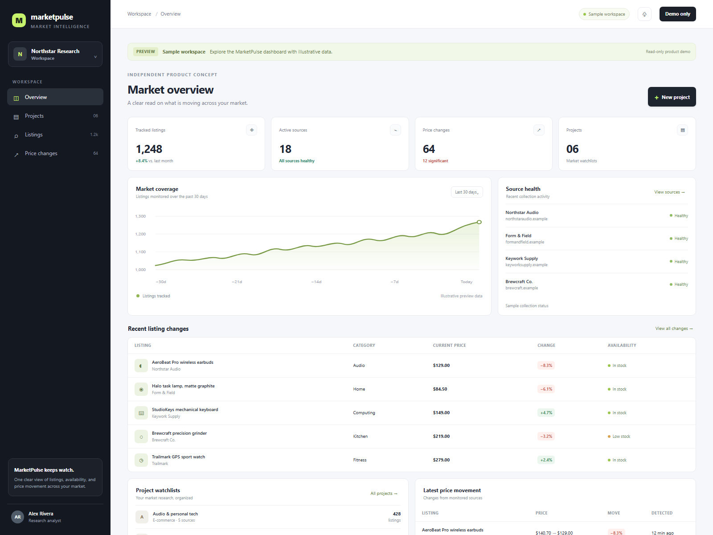
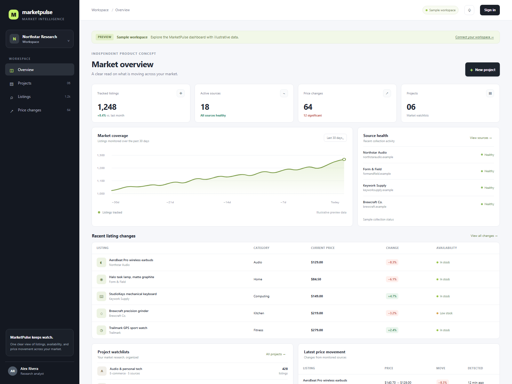
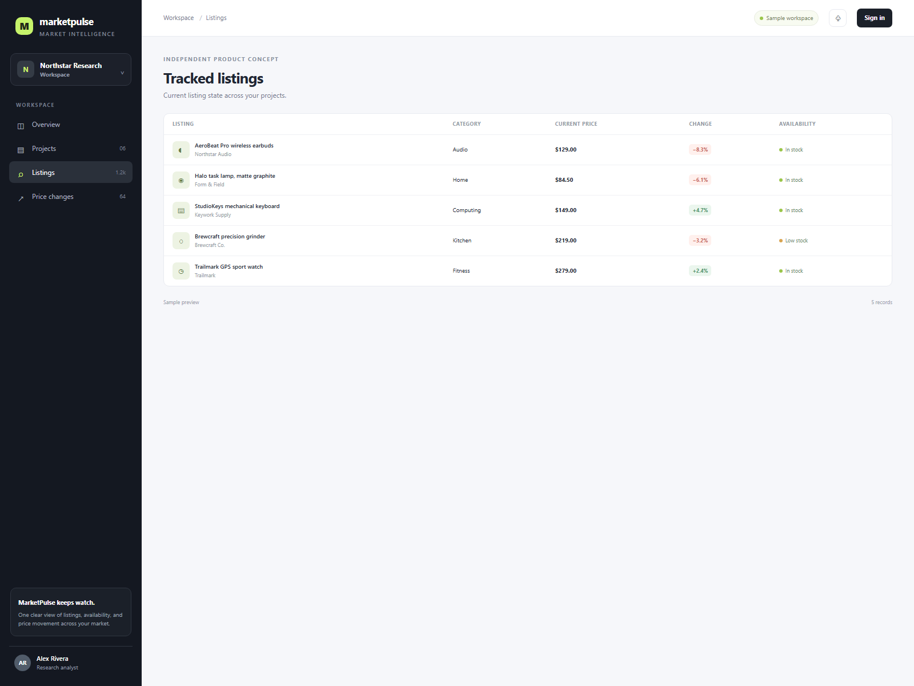
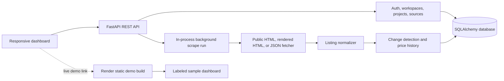

# MarketPulse

MarketPulse is a market-monitoring dashboard with a FastAPI backend and a responsive vanilla HTML, CSS, and JavaScript frontend. Its scraping pipeline supports static HTML, JavaScript-rendered pages, and JSON APIs, then normalizes listings, tracks price history, and detects changes.

**Live read-only demo:** [marketpulse-demo-adqo.onrender.com](https://marketpulse-demo-adqo.onrender.com) — uses labeled sample data; account and API actions are disabled.

[](https://marketpulse-demo-adqo.onrender.com)

## Screenshots

| Dashboard | Listings and price changes |
| --- | --- |
|  |  |

## Architecture



## Run with Docker Compose

1. Copy `.env.example` to `.env`.
2. Set `POSTGRES_PASSWORD`, update the password in `DATABASE_URL` to match it, and replace `JWT_SECRET` with a random secret of at least 32 bytes.
3. Run `docker compose up --build`.
4. Open <http://localhost:3000>. The API docs are at <http://localhost:8000/docs>.

The first account created becomes the initial workspace administrator. Public registration closes after that account exists. The UI can create projects, configure a source, and start a scrape with its **Run now** button. Scrapes run as in-process FastAPI background tasks; there is no durable queue or schedule worker yet.

## Roadmap

- Durable scrape queue and scheduled runs
- Change alerts and notification channels
- Downloadable CSV, Excel, and PDF reports
- Expanded workspace roles and team permissions

## Deploying

Use a persistent PostgreSQL service for `DATABASE_URL`; the default SQLite database is suitable only for local development. Set a unique `JWT_SECRET`, set `CORS_ORIGINS` to the exact origin serving the frontend, and set `MARKETPULSE_API_URL` on the frontend service to the public API base URL ending in `/api/v1`. The API container exposes port 8000 and provides `/health` for platform health checks. The frontend container serves the static UI on port 80.

### Public portfolio demo

`render.yaml` defines the static, read-only demo currently linked above. It publishes the dashboard with labeled sample data and disables account/API actions; no database or API service is created for the demo. The full API and database are not part of this demo deployment.

## Portfolio materials

The responsive dashboard opens in a clearly labeled sample preview. The Contra case-study draft and portfolio screenshots are in `portfolio/`.

### Source selector configuration

For static or JavaScript-rendered HTML, map output fields to CSS selectors. An item selector repeats the field mappings for each matching element:

```json
{"item":"article.product","title":"h2","url":{"selector":"a","attr":"href"},"price":".price","availability":".stock"}
```

For JSON APIs, `items_path` selects the array and each remaining value is a dot-separated path inside an item:

```json
{"items_path":"data.products","title":"name","url":"url","price":"price","currency":"currency"}
```

Scrapes check `robots.txt`, accept only public HTTP(S) hosts, follow at most five redirects, and cap response size at 8 MiB and extracted records at 5,000. A run with no valid listings is marked failed; it never marks all existing listings as removed. Successful runs update current snapshots, append price/availability history, and record detected changes. Use `POST /api/v1/sources/{source_id}/runs` to start a run and `GET /api/v1/sources/{source_id}/runs` to inspect it. Listing changes are available from `GET /api/v1/projects/{project_id}/changes`.

## Local backend development

From `backend`, create a virtual environment, install `requirements.txt`, then set `JWT_SECRET` and optionally `DATABASE_URL` before running `uvicorn app.main:app --reload`. SQLite is used by default for local development.
